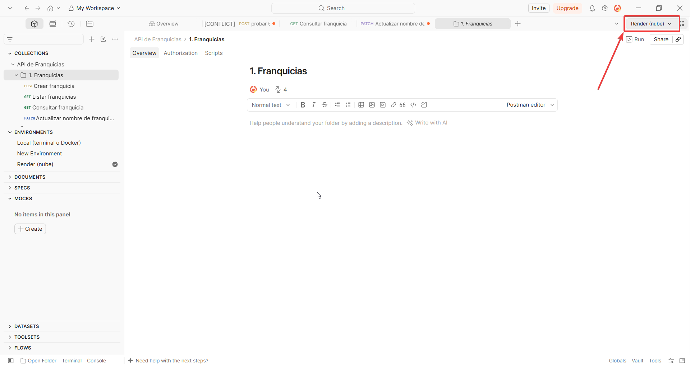

# APIS de Franquicias

API REST **reactiva** para gestionar franquicias, sus sucursales y los productos de cada sucursal.
Desarrollada como prueba técnica para el rol de Backend Developer.

## Tecnologías

| Área | Herramienta |
|---|---|
| Lenguaje y framework | Java 21, Spring Boot 4.1, Spring WebFlux |
| Persistencia | MongoDB reactivo (Spring Data Reactive MongoDB) |
| Base de datos en la nube | MongoDB Atlas (clúster M0 sobre AWS) |
| Infraestructura como código | Terraform (provider `mongodb/mongodbatlas`) |
| Contenedores | Docker (build multi-stage) y Docker Compose |
| Despliegue | Render (servicio web con Docker) |
| Pruebas | JUnit 5, Mockito, Reactor Test (`StepVerifier`), JaCoCo |

## Demo en la nube

La API está desplegada en **Render** (contenedor Docker) y usa la base de datos de **MongoDB Atlas** creada con Terraform:

**https://prueba-accenture.onrender.com**

```bash
curl https://prueba-accenture.onrender.com/api/franquicias
```

> El plan gratuito de Render apaga el servicio tras 15 minutos sin tráfico. La primera petición después de ese tiempo puede tardar entre 30 y 60 segundos mientras el servicio arranca; las siguientes responden con normalidad.

## Arquitectura

El proyecto sigue **Clean Architecture**: las dependencias apuntan hacia el dominio, y el dominio no conoce Spring ni MongoDB.

```
src/main/java/com/Prueba/Accenture
├── config                 → UseCaseConfig: registra los casos de uso como @Bean
├── domain
│   ├── exception          → FranquiciaException (400), RecursoNoEncontradoException (404)
│   ├── interfaces         → FranquiciaRepositorio (puerto de persistencia)
│   ├── model              → Franquicia, Sucursal, Producto, Descripcion, TopStockProduct
│   └── usecase            → FranquiciaUseCase, SucursalUseCase, ProductUseCase
└── infraestructura
    ├── adapters           → implementación del puerto con MongoDB (documentos, mapper, repositorio)
    └── points
        ├── dto            → objetos de entrada y salida de la API
        ├── handler        → atienden las peticiones y llaman a los casos de uso
        ├── routers        → definen las rutas (RouterFunction)
        └── ManejoErrores  → filtro que traduce excepciones a 400 / 404 / 500
```

- **Dominio:** contiene el modelo y las reglas de negocio en Java. El modelo es inmutable: cada operación devuelve una copia nueva.
- **Casos de uso:** uno por entidad del agregado. Orquestan el flujo y dependen solo de la interfaz `FranquiciaRepositorio`.
- **Infraestructura:** implementa la interfaz con Spring Data Reactive MongoDB y expone la API con el estilo funcional de WebFlux (`RouterFunction` + `Handler`).

## Requisitos

- **Docker Desktop**, para la opción recomendada.
- **Java 21**, solo si se ejecuta desde el código.
- **Terraform 1.5 o superior** y una cuenta de MongoDB Atlas, solo para aprovisionar la base de datos en la nube.
- **Postman**, opcional, para probar la API con la colección incluida.

Para probar solo la demo en la nube con Postman no hace falta instalar Docker, Java ni Terraform.

### Instalar Docker

**Windows**

1. Activar WSL 2: abrir **PowerShell como administrador**, ejecutar `wsl --install` y reiniciar el equipo.
2. Descargar e instalar [Docker Desktop para Windows](https://docs.docker.com/desktop/setup/install/windows-install/), con la opción **Use WSL 2** marcada.
3. Abrir Docker Desktop y esperar a que indique **Engine running**.

**macOS**

- Descargar e instalar [Docker Desktop para Mac](https://docs.docker.com/desktop/setup/install/mac-install/) (elegir la versión Apple Silicon o Intel según el equipo), o con Homebrew:

```bash
brew install --cask docker
```

**Linux (Ubuntu / Debian)**

```bash
curl -fsSL https://get.docker.com | sh
sudo usermod -aG docker $USER   # usar Docker sin sudo (cerrar sesión y volver a entrar)
```

Guía oficial: [Install Docker Engine](https://docs.docker.com/engine/install/).

**Verificar la instalación** (en cualquier sistema):

```bash
docker --version
docker compose version
docker run hello-world   # debe mostrar "Hello from Docker!"
```

### Instalar Terraform

Solo es necesario para aprovisionar MongoDB Atlas (sección [Infraestructura como código](#infraestructura-como-código-terraform)).

**Windows** (PowerShell):

```powershell
winget install Hashicorp.Terraform
```

Después, cerrar y volver a abrir la terminal (y el IDE, si se usa su terminal) para que reconozca el comando.

**macOS** (Homebrew):

```bash
brew tap hashicorp/tap
brew install hashicorp/tap/terraform
```

**Linux (Ubuntu / Debian)**:

```bash
wget -O - https://apt.releases.hashicorp.com/gpg | sudo gpg --dearmor -o /usr/share/keyrings/hashicorp-archive-keyring.gpg
echo "deb [arch=$(dpkg --print-architecture) signed-by=/usr/share/keyrings/hashicorp-archive-keyring.gpg] https://apt.releases.hashicorp.com $(lsb_release -cs) main" | sudo tee /etc/apt/sources.list.d/hashicorp.list
sudo apt update && sudo apt install terraform
```

Guía oficial: [Install Terraform](https://developer.hashicorp.com/terraform/install).

**Verificar la instalación:**

```bash
terraform -version
```

**Alternativa sin instalar Terraform:** si Docker ya está instalado, Terraform se puede ejecutar desde un contenedor, dentro de la carpeta `infra/`:

```bash
docker run --rm -it -v "$(pwd):/infra" -w /infra hashicorp/terraform:1.9 init
docker run --rm -it -v "$(pwd):/infra" -w /infra hashicorp/terraform:1.9 apply
```

En Git Bash para Windows, usar `$(pwd -W)` en lugar de `$(pwd)`.

## Cómo ejecutar

### Opción 1: todo con Docker (recomendada)

Levanta la API y un MongoDB local, sin instalar Java:

```bash
docker compose --profile app up --build
```

La API queda disponible en `http://localhost:8080`. Para detenerla:

```bash
docker compose --profile app down
```

### Opción 2: desde el código

Con Docker Desktop abierto (Spring Boot levanta el MongoDB de `compose.yaml` automáticamente):

```bash
./mvnw spring-boot:run
```

### Opción 3: con la base de datos en MongoDB Atlas

1. Aprovisionar la infraestructura (ver la sección [Infraestructura como código](#infraestructura-como-código-terraform)).
2. Exportar la cadena de conexión y levantar la API:

```bash
export MONGODB_URI="$(terraform -chdir=infra output -raw mongodb_uri)"
docker compose --profile app up --build
```

En PowerShell:

```powershell
$env:MONGODB_URI = terraform -chdir=infra output -raw mongodb_uri
docker compose --profile app up --build
```

## Cómo probar la API

### Opción recomendada: Postman

La carpeta `postman/` incluye una colección con **24 peticiones** (todos los endpoints y los casos de error) y dos entornos. Cada petición guarda los ids que usan las siguientes y verifica su respuesta, así que no hay que copiar nada a mano.

| Entorno | `baseUrl` | Cuándo usarlo |
|---|---|---|
| `Local (terminal o Docker)` | `http://localhost:8080` | La API corre con `./mvnw spring-boot:run` o con `docker compose --profile app up --build` |
| `Render (nube)` | `https://prueba-accenture.onrender.com` | Probar la demo desplegada, sin ejecutar nada localmente |

1. En Postman: **Import** y seleccionar los tres archivos de la carpeta `postman/`.
2. Elegir el entorno en el selector de la esquina superior derecha de Postman (donde dice **No Environment**): **Local (terminal o Docker)** o **Render (nube)**.

   

3. En la colección **API de Franquicias**, abrir el menú **...** → **Run** → **Start run**. Se ejecutan las 24 peticiones en orden (Franquicias → Sucursales → Productos → Errores) y Postman muestra cuáles pasaron.

También se puede abrir cada petición y enviarla por separado con **Send**, siguiendo el orden de las carpetas.

### Alternativa: curl

Los ejemplos con `curl` están en la sección [Endpoints](#endpoints). En ese caso los ids de franquicia, sucursal y producto se copian a mano de cada respuesta.

## Pruebas y cobertura

```bash
./mvnw clean test
```

- **39 pruebas unitarias** sobre los casos de uso, con el repositorio simulado con Mockito y los flujos reactivos verificados con `StepVerifier`.
- Reporte de cobertura de JaCoCo en `target/site/jacoco/index.html`.
- Cobertura de líneas: **58 % total**; **100 %** en casos de uso y excepciones, y **97 %** en el modelo de dominio.

## Infraestructura como código (Terraform)

La carpeta `infra/` aprovisiona en MongoDB Atlas:

- Un proyecto (`franquicias-api`).
- Un clúster gratuito **M0** sobre AWS (`US_EAST_1`).
- Un usuario con permiso `readWrite` únicamente sobre la base `franquicias` (mínimo privilegio).
- La lista de IPs con acceso al clúster.

Pasos:

```bash
cd infra
cp terraform.tfvars.example terraform.tfvars   # completar con las credenciales propias
terraform init
terraform plan
terraform apply
terraform output -raw mongodb_uri               # cadena de conexión para MONGODB_URI
```

Las credenciales se leen de `terraform.tfvars`, y la autenticación usa una **Service Account** de Atlas con rol Organization Owner. Ni `terraform.tfvars` ni `terraform.tfstate` se versionan (están en `.gitignore`).

Para eliminar todo lo creado: `terraform destroy`.

## Despliegue en Render

El servicio se crea en Render como **Web Service** con runtime **Docker**, a partir de la rama `main` de este repositorio. Render construye la imagen con el `Dockerfile` y vuelve a desplegar en cada push.

Variables de entorno configuradas en Render:

| Variable | Valor |
|---|---|
| `MONGODB_URI` | Cadena de conexión de Atlas (salida de `terraform output -raw mongodb_uri`) |
| `SPRING_DATA_MONGODB_URI` | La misma cadena (compatibilidad con el nombre anterior de la propiedad) |
| `JAVA_TOOL_OPTIONS` | `-XX:MaxRAMPercentage=75`, para ajustar la memoria de Java a los 512 MB del plan gratuito |

La aplicación lee el puerto de la variable `PORT` que define Render (`server.port=${PORT:8080}`).

## Endpoints

| Método | Ruta | Descripción |
|---|---|---|
| POST | `/api/franquicias` | Crear una franquicia |
| GET | `/api/franquicias` | Listar las franquicias |
| GET | `/api/franquicias/{id}` | Consultar una franquicia |
| PATCH | `/api/franquicias/{id}/nombre` | Actualizar el nombre de una franquicia |
| POST | `/api/franquicias/{franquiciaId}/sucursales` | Agregar una sucursal a la franquicia |
| GET | `/api/franquicias/{franquiciaId}/sucursales` | Listar las sucursales de la franquicia |
| PATCH | `/api/franquicias/{franquiciaId}/sucursales/{sucursalId}/nombre` | Actualizar el nombre de una sucursal |
| POST | `/api/franquicias/{franquiciaId}/sucursales/{sucursalId}/productos` | Agregar un producto a la sucursal |
| DELETE | `/api/franquicias/{franquiciaId}/sucursales/{sucursalId}/productos/{productoId}` | Eliminar un producto de la sucursal |
| PATCH | `/api/franquicias/{franquiciaId}/sucursales/{sucursalId}/productos/{productoId}/stock` | Modificar el stock de un producto |
| PATCH | `/api/franquicias/{franquiciaId}/sucursales/{sucursalId}/productos/{productoId}/nombre` | Actualizar el nombre de un producto |
| GET | `/api/franquicias/{franquiciaId}/productos/top-stock` | Producto con más stock de cada sucursal |

### Ejemplos con curl

Crear una franquicia:

```bash
curl -X POST http://localhost:8080/api/franquicias \
  -H "Content-Type: application/json" \
  -d '{"nombre":"Frisby","descripcion":"Venta de pollo apanado"}'
```

Agregar una sucursal:

```bash
curl -X POST http://localhost:8080/api/franquicias/{franquiciaId}/sucursales \
  -H "Content-Type: application/json" \
  -d '{"nombre":"Centro","descripcion":"Calle 10"}'
```

Agregar un producto:

```bash
curl -X POST http://localhost:8080/api/franquicias/{franquiciaId}/sucursales/{sucursalId}/productos \
  -H "Content-Type: application/json" \
  -d '{"nombre":"Papas","descripcion":"A la francesa","stock":10}'
```

Modificar el stock:

```bash
curl -X PATCH http://localhost:8080/api/franquicias/{franquiciaId}/sucursales/{sucursalId}/productos/{productoId}/stock \
  -H "Content-Type: application/json" \
  -d '{"stock":25}'
```

Producto con más stock por sucursal:

```bash
curl http://localhost:8080/api/franquicias/{franquiciaId}/productos/top-stock
```

Respuesta:

```json
[
  {"sucursalId":"...","sucursalNombre":"Centro","productoId":"...","productoNombre":"Papas","stock":25}
]
```

Para probar contra la demo, reemplazar `http://localhost:8080` por `https://prueba-accenture.onrender.com`.

### Respuestas de error

Todos los errores responden con el formato `{"error": "mensaje"}`:

| Código | Cuándo |
|---|---|
| 400 | Nombre vacío o repetido, stock negativo o ausente, descripción de más de 255 caracteres, JSON mal formado |
| 404 | La franquicia, la sucursal o el producto no existen |
| 500 | Error inesperado (el detalle queda en el log, no se expone al cliente) |

## Decisiones de diseño

- **Un documento por franquicia.** La franquicia se guarda en MongoDB con sus sucursales y productos anidados. Cada operación modifica un solo documento, así que es atómica y no requiere relaciones. Si una franquicia llegara a tener miles de productos, se separarían en colecciones.
- **Ids UUID generados por el dominio.** MongoDB solo genera `_id` para el documento principal, no para los subdocumentos; con UUID cada sucursal y producto tiene su propio id.
- **Modelo inmutable.** Las entidades no tienen setters; las reglas de negocio (nombres obligatorios y no repetidos, stock no negativo) viven en el modelo.
- **Producto con más stock:** si dos productos empatan, se devuelve uno de ellos; las sucursales sin productos no aparecen en la respuesta.
- **Descripción opcional** en franquicias, sucursales y productos (máximo 255 caracteres); vacía se guarda como `null`.
- **Acceso al clúster de Atlas desde `0.0.0.0/0`**, protegido por usuario y contraseña, porque el plan gratuito de Render no tiene una IP de salida fija. En producción se restringiría a las IPs del servidor o se usaría conexión privada (peering).

